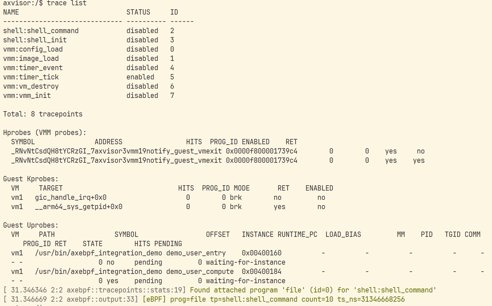

# 9.28 ~ 10.11

## 本周进展

### 跑通 axebpf 模块测试

axebpf 中有用于测试模块逻辑的 `tests/*.rs`，但是目前这些模块测试依赖于 AxVisor workspace 的构建配置和测试资源：
- axalloc 使用 workspace = true，需要根目录提供依赖来源；它实际来自 ArceOS。
- runtime 测试需要仓库根目录 target/bpf/ 中的预编译 .o 文件。
补齐这些依赖配置和测试文件后，就可以将 axebpf 放进独立 workspace，在宿主机跑测试。测试本身不要求启动 AxVisor。

目前已通过拉取 AxVisor 的 feat/ebpf 分支代码跑通模块测试。

### 跑通 axebpf 主线手工联调

axebpf 的手工联调需要在 QEMU 中启动 AxVisor 和 Linux guest，通过 AxVisor shell 加载符号表和 eBPF 程序，再挂载探针：
- Hypervisor、guest 内核和用户程序的符号用于定位被观测函数。
- `printk.o` 提供探针命中后的计数和输出逻辑，同一个程序可以绑定到不同探针和 tracepoint。
- guest 中的 `axebpf_integration_demo` 产生可重复的函数调用，用于观察入口和返回探针是否命中。

目前已按照主线手工联调指南跑通流程，验证了 hprobe、hretprobe、guest-kprobe、guest-kretprobe、uprobe、uretprobe 和 tracepoint 七类观测能力。通过运行期命中日志确认探针触发，并观察到 guest demo 正常执行结束。相比宿主机模块测试，手工联调进一步验证了 axebpf 与 AxVisor 的地址翻译、异常处理和 eBPF 执行链路能够协同工作。

以下是手工联调过程中七种探测功能具体的验证方式：

启动虚拟机后的运行记录见 [week3](week3.log)，其中包含六类探针命中以及命中计数累加的日志。

### 分析 axebpf 源码

结合手工联调中的 `trace hprobe` 命令，阅读了 axebpf 从符号查询、探针设置到命中后执行 eBPF 程序的源码，梳理了以下流程：
- 符号定位：AxVisor 构建时生成与 `ksym` 约定一致的压缩符号表，axebpf 的 `symbols` 模块通过它将函数名称解析为地址。该符号表对应 Hypervisor 自身。
- 探针设置：AxVisor shell 根据命令树调用 `trace_hprobe()`，再进入 axebpf 的 manager 注册目标地址和程序 ID；底层 `kprobe` 库配合平台操作保存原指令、写入 `BRK`，并准备原指令槽。
- 命中处理：CPU 执行断点后进入异常处理，axebpf handler 根据 `BRK #4/#6` 区分命中与原指令执行完成阶段，再根据 PC 找到对应探针，调用注册时保存的回调。
- 程序执行：入口回调取得绑定的程序 ID，将 `PtRegs` 寄存器现场作为上下文传给 `runtime`，由 rbpf 注册 helpers 并解释执行 eBPF 字节码；随后通过指令槽执行原指令并恢复原函数执行。

## 下一步计划

- 通过阅读源码发现 axebpf 的 `hprobe`、`kprobe`、`uprobe` 三个子模块代码都比较冗长，且其中存在功能边界不清晰的问题，例如 `hprobe` 子模块使用 `KprobeRegistry`，可能存在重构空间，可考虑重构这部分代码。
- axebpf 的模块测试尚依赖于 AxVisor 的依赖配置以及 eBPF 二进制，可考虑消除这部分依赖。
